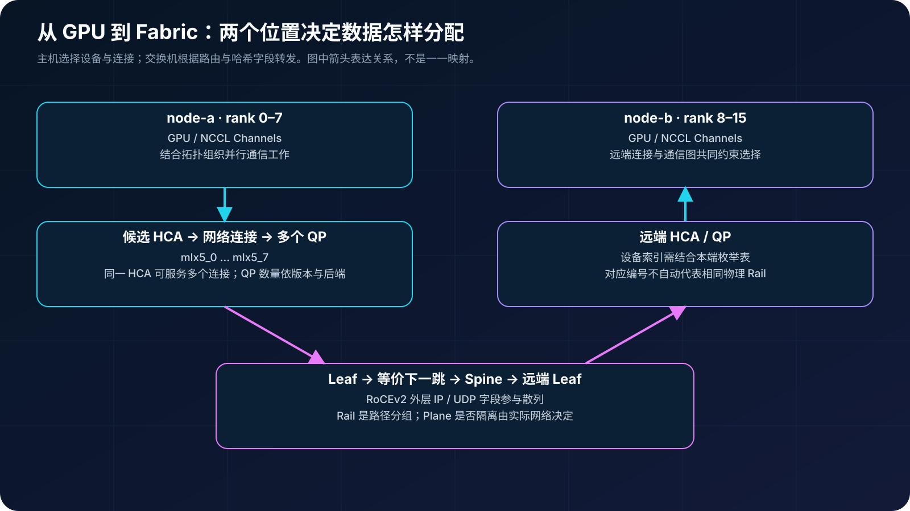
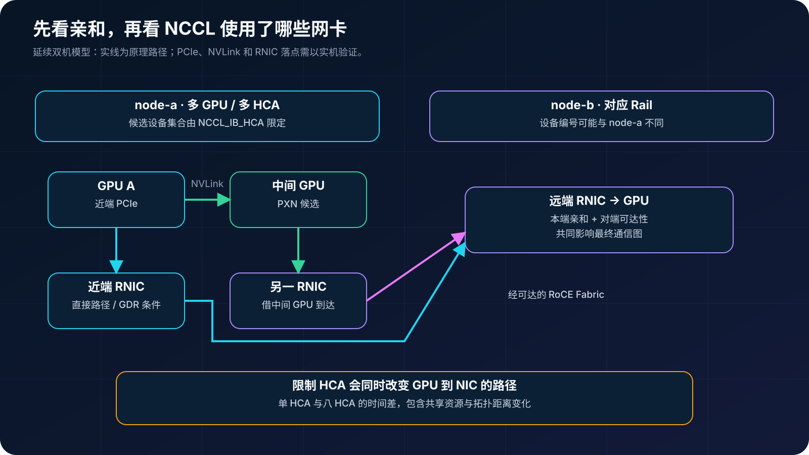
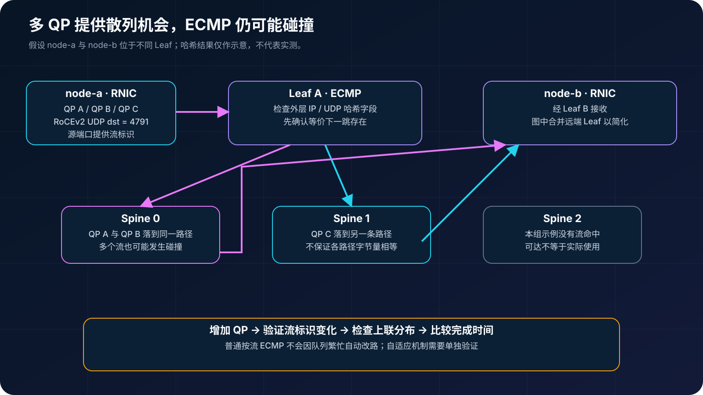
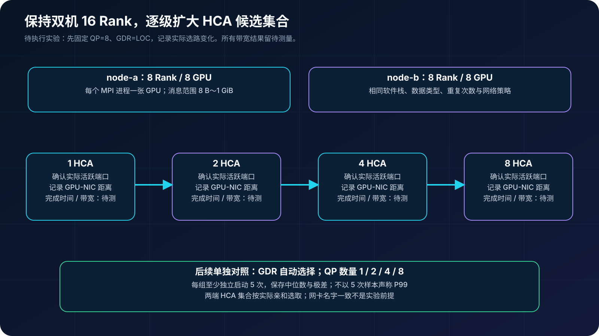
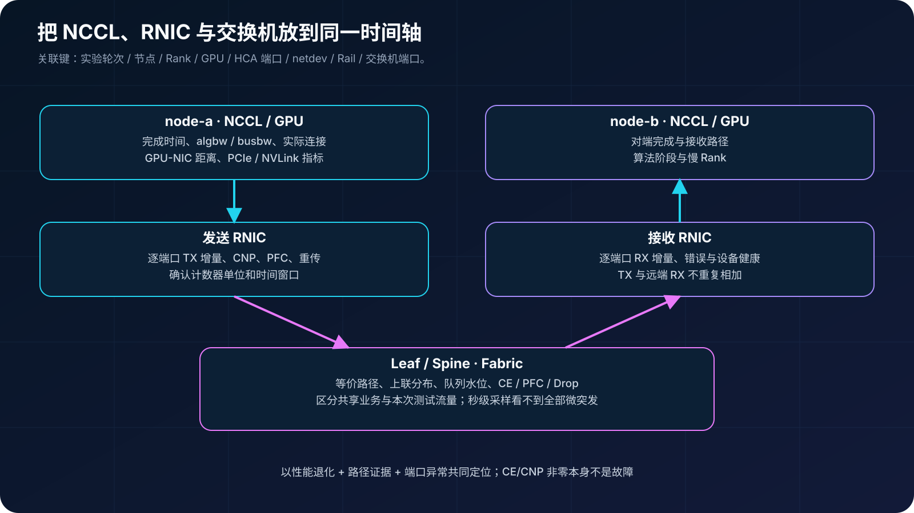

## 0. 前言

[上一篇双机 16 卡 DDP 实战](../pytorch-ddp-16gpu-end-to-end/)中，两台八卡 H200 服务器完成了进程集合、NCCL 建链和训练。日志里，NCCL 发现了每台机器的 8 个 RoCE HCA。接下来我们继续追问：这些网卡怎样参与通信，数据出网后怎样选择 Spine，又怎样证明多网卡带来了收益？

本文沿用 node-a、node-b 和 global rank 0–15。已有日志用于解释已经发生的连接；性能部分提供待执行的实验方案，暂不填入未经测量的带宽结果。案例没有提供完整交换机布线与端口速率，文中的 Clos 和 400G 算例均为原理说明。

## 1. 先分清六个层次

| 术语 | 本文含义 | 不应直接等同于 |
| --- | --- | --- |
| Rank | Communicator 内的参与者编号；本例一进程一 GPU | 网卡编号 |
| Channel | NCCL 并行组织通信工作的逻辑通道 | 独占网卡或一条线缆 |
| HCA / RNIC | RDMA 设备及其可用端口 | 必然独立的物理卡；多端口卡和虚拟功能需另核对 |
| Rail | 跨节点对应 NIC 与连接网络组成的逻辑路径分组 | 单条光纤、VLAN 或必然隔离的 Plane |
| QP | RDMA Queue Pair；本例内置 IB 后端使用 RC 连接 | 一条指定的 Spine 路径 |
| ECMP | 在等价下一跳之间选择转发路径 | NCCL 的网卡选择策略 |



可以从两个位置理解数据分配：主机侧决定通信通过哪些 GPU、网卡和连接；交换机侧依据路由与哈希配置决定报文经过哪条上联。这两个位置都可能产生不均衡，但排查方法不同。

## 2. 上一篇日志究竟证明了什么

下面摘自上一篇同一作业的脱敏记录。省略号表示删去重复设备条目或日志字段，node 名称由原始主机映射而来：

```text
[node-a] NCCL version 2.19.3+cuda12.3
[node-a] NET/IB : Using [0]mlx5_0:1/RoCE ... [7]mlx5_7:1/RoCE [RO]
[node-a] Using network IB
[node-a] Channel 00/04 : 0 7 6 5 4 3 2 9 8 15 14 13 12 11 10 1
[node-a] 2[2] -> 9[1] [send]    via NET/IB/0
[node-b] 2[2] -> 9[1] [receive] via NET/IB/0
[node-b] 10[2] -> 1[1] [send]    via NET/IB/0
[node-a] 10[2] -> 1[1] [receive] via NET/IB/0
```

设备枚举说明 8 个 HCA 端口进入候选集合；Channel 行说明逻辑 Ring 顺序；发送和接收的镜像记录说明这条跨机连接的两端已配置。它们都没有给出逐端口传输了多少字节。

尤其不能看到 `NET/IB/0` 就断定整个任务只用了 mlx5_0。它是该次运行、该网络后端的设备索引，必须与本端枚举表配对，而且摘录只覆盖部分连接。调整 HCA 白名单后，索引还可能重新编号。

案例使用内置 IB verbs 后端，设备明确显示 RoCE；`Using network IB` 不能解释成原生 InfiniBand。NCCL 2.19.3 的[设备枚举源码](https://github.com/NVIDIA/nccl/blob/v2.19.3-1/src/transport/net_ib.cc)也分别记录设备索引、设备名、端口和链路类型。

上一篇的模型只有 22 个 FP32 参数，裸梯度 88 字节。即使 8 个端口都可用，小消息也未必产生足够持续的数据流来利用它们。到这里，我们能确认功能链路完成，尚不能评价多网卡聚合效率。

## 3. NCCL 怎样选择网卡

### 3.1 先查 GPU 到 NIC 的距离

延续[GPU-NIC 拓扑篇](../nccl-allreduce-gpu-nic-topology/)，先还原本地映射：

```bash
nvidia-smi topo -m
lspci -tv
ibdev2netdev
rdma link show
numactl -H
```

把每张 GPU 的 PCIe 路径、NUMA、近端 HCA、netdev 与交换机端口记下来。GPU0 和 mlx5_0 数字相同并不保证亲和；两节点也可能因为枚举顺序不同，需要不同的设备白名单才能选中对应 Rail。



NCCL 会结合本地距离、可用设备、远端连接和通信图构造路径。支持 PXN 时，数据可以先经过 NVLink 到中间 GPU，再借助其近端 NIC 出网。允许 PXN 不代表每一次通信都使用 PXN，也不意味着被排除的 HCA 会重新可用。

### 3.2 HCA 白名单只定义候选集合

`NCCL_IB_HCA` 可以限制候选设备；`NCCL_CROSS_NIC` 则影响 Ring/Tree 是否尝试在节点间保持 NIC/Rail 对应关系。案例版本中，0 倾向保持同 Rail，1 不要求这种对应，默认 2 在对应关系与性能之间选择。即使设为 0，也不能据此承诺任意完全隔离的 Rail 都能工作。具体语义见 [NCCL 2.19.3 环境变量文档](https://docs.nvidia.com/deeplearning/nccl/archives/nccl_2193/user-guide/docs/env.html#nccl-cross-nic)。

```bash
# 精确匹配设备名和端口；这里假定每个设备的有效端口均为 1
export NCCL_IB_HCA='=mlx5_0:1,mlx5_1:1'
```

这段配置允许使用两个端口，并不承诺两个端口平均分担 Payload。Channel、网络连接和 QP 的数量还受到算法、通信方向、连接共享及插件实现影响，不能套用“一个 Channel 对应一张 NIC、一个 QP”的固定模型。

### 3.3 保留案例的 GDR 差异

案例设置了 `NCCL_NET_GDR_LEVEL=LOC`，其语义是禁用 GPUDirect RDMA。通过 RNIC 使用 RDMA 与 RNIC 直接访问 GPU 显存是两个不同条件：GDR 被禁用时，网络通信仍可能通过主机内存中转。

因此，先复现该配置，再单独比较 GDR 自动选择，不能在增加 HCA 数量的同时解除 GDR 限制，否则两种收益会混在一起。当前版本参数含义以 [NCCL 当前环境变量文档](https://docs.nvidia.com/deeplearning/nccl/user-guide/docs/env.html#nccl-net-gdr-level-formerly-nccl-ib-gdr-level)为准，并记录运行时实际加载的 NCCL 版本。

## 4. 从 QP 到 RoCE ECMP

### 4.1 交换机看见的是什么

RoCEv2 在以太网中使用 IP/UDP 封装，通常以 UDP 目的端口 4791 标识；UDP 源端口承载可供网络散列使用的流标识。对于常见 RC 实现，不同 QP 可以产生不同的源端口，为 ECMP 提供熵；具体生成规则由 RNIC、固件与驱动实现决定。[NVIDIA RoCE 说明](https://networking-docs.nvidia.com/mlnxofedswum/586042lts/rdma-over-converged-ethernet-roce)介绍了这种封装目的。

```text
Ethernet | IP(src,dst) | UDP(src port,dst=4791) | RDMA transport | Payload
                         ↑ 提供散列差异的一个重要字段
```

普通 ECMP 通常从配置的外层报文字段计算哈希。QPN 位于 RDMA 头部，不等于普通交换机必然直接对 QPN 散列。实际是否包含 UDP 端口、IPv6 Flow Label，以及是否开启对称哈希，都应检查设备配置。



本图假设两节点挂在不同 Leaf，流量需要经过 Spine。如果两端对应 NIC 位于同一 Leaf，数据可能本地转发，这种场景不能用来验证 Spine ECMP。

### 4.2 8 个 QP 不等于占用 8 条上联

`NCCL_IB_QPS_PER_CONNECTION` 调整每个网络连接的 QP 数量。增加 QP 可能提供更多可被散列区分的流，但收益至少取决于：

- 多个 QP 是否实际承载 Payload，而非仅完成创建；
- 源端口等散列字段是否发生变化；
- 路由表是否存在多个等价下一跳；
- 多个流是否碰巧落到同一成员链路；
- 消息是否足够大，以及新增 QP 的资源与调度开销。

静态按流 ECMP 不会因为某条队列拥塞就自动把该流迁到空闲路径。自适应路由、flowlet 或按包分散需要设备和端点成套支持，不能与普通 ECMP 混称，也不能直接在生产网络开启逐包轮询而忽略乱序。

同一连接中多个 QP 如何承载消息，还依赖 NCCL 版本与后端实现。涉及分片或轮转参数时，应查实际版本文档/源码；本文只扫描 QP 数量，不把某个版本的默认分配行为当成通用规律。

### 4.3 与千卡拓扑的关系

[千卡网络建设篇](../rocev2-1024-gpu-network-design/)讨论了 Rail、Plane 和收敛比。现在可以反过来检查：即使主机把数据分到 8 个 Rail，如果这些 Rail 共享有收敛的上联、PCIe 资源或热点出口，总吞吐仍受共享瓶颈限制。多网卡和 ECMP 都不能替代缺少的物理容量。

## 5. 为什么增加网卡不一定线性提速

| 观察到的现象 | 可能的限制 | 下一步证据 |
| --- | --- | --- |
| 小消息几乎不加速 | 启动、同步和软件调度开销占比高 | 扫描消息尺寸，比较延迟曲线 |
| 多 NIC 都不忙 | 算法、节点内路径、Host Staging 或输入量不足 | NCCL 日志、NVLink/PCIe、CPU 内存指标 |
| 一个 NIC 忙，其余空闲 | 实际连接选择集中或当前阶段分工不同 | GRAPH/NET 与逐端口时间序列 |
| NIC 发得多，Spine 分布偏斜 | 哈希碰撞、等价路径缺失或共享业务 | 路由成员、流标识与上联计数器 |
| NIC 都有流量，完成时间仍抖 | 慢 Rail、拥塞、重传或远端落点瓶颈 | 队列、CE/CNP、PFC、RDMA 异常 |

例如一张 400Gb/s 端口的单向名义速率为 50GB/s，8 张是 400GB/s。这是端口容量算例，不是 AllReduce `busbw` 的必达目标，也没有扣除协议开销。

对固定 16 Rank 的 AllReduce，nccl-tests 定义：

```text
algbw = 每 Rank 数据量 S / 完成时间 t
busbw = algbw × 2 × (16-1)/16 = algbw × 1.875
```

`busbw` 是按 collective 模型归一化的指标，不是每节点 8 张 NIC 的吞吐之和。NVLS、分层通信和多网卡会改变物理流量分布；比较链路容量时必须同时看端口实测。定义参考 [nccl-tests PERFORMANCE](https://github.com/NVIDIA/nccl-tests/blob/master/doc/PERFORMANCE.md)。

## 6. 待执行：1、2、4、8 HCA 对照实验

### 6.1 固定什么，改变什么

这一节尚未在案例机器上执行。实验固定两台机器、16 个 MPI Rank、每进程一张 GPU、数据类型、消息范围与软件版本；先只改变 HCA 候选集合。记录每轮实际算法、Channel 与 HCA 使用，允许 NCCL 自动选路，这样测到的是候选网卡增加后的整体效果。

主实验按近端关系选择 1、2、4、8 HCA。为了检查单端口差异，再把八个 HCA 分别单独跑一次。两 HCA 和四 HCA 组应覆盖合理的 NUMA/PCIe 分布，不能仅按编号连续取前几个。



### 6.2 构建与启动模板

前提：两节点具有相同的软件环境、可用的 RDMA 设备与 GPU 权限、匹配的 MTU/QoS、可达的控制网络。以下使用 Open MPI；node-a/node-b 是需替换或配置解析的主机别名。

按照 [nccl-tests README](https://github.com/NVIDIA/nccl-tests)在选定版本源码目录构建，并把同一产物部署到两节点相同路径：

```bash
make -j MPI=1 NAME_SUFFIX=_mpi
```

MPI、CUDA 或 NCCL 不在默认位置时，按 README 设置对应 HOME 参数。下面使用明确的 MPI 后缀，防止误运行不支持跨进程集合的构建。

```bash
# 在选定的 nccl-tests 目录执行；路径需在两节点均存在。
export NCCL_DEBUG=INFO
export NCCL_DEBUG_SUBSYS=INIT,GRAPH,NET,TUNING
export NCCL_SOCKET_IFNAME='=bond0'
export NCCL_IB_DISABLE=0

# 第一阶段固定案例的 QP 和 GDR 配置。
export NCCL_IB_QPS_PER_CONNECTION=8
export NCCL_NET_GDR_LEVEL=LOC

# 下列名字仅作模板；先确认两端设备与 Rail 的映射一致。
export NCCL_IB_HCA='=mlx5_0:1'
# 后续每次只替换此行，例如：
# export NCCL_IB_HCA='=mlx5_0:1,mlx5_4:1'
# export NCCL_IB_HCA='=mlx5_0:1,mlx5_2:1,mlx5_4:1,mlx5_6:1'
# export NCCL_IB_HCA='=mlx5_0:1,mlx5_1:1,mlx5_2:1,mlx5_3:1,mlx5_4:1,mlx5_5:1,mlx5_6:1,mlx5_7:1'

# 每轮修改标识，防止覆盖日志；/tmp 在两节点本地均应可写。
export NCCL_DEBUG_FILE='/tmp/nccl-hca1-run1.%h.%p.log'

mpirun --host node-a:8,node-b:8 -np 16 \
  --map-by ppr:8:node --bind-to none \
  -x NCCL_DEBUG -x NCCL_DEBUG_SUBSYS -x NCCL_DEBUG_FILE \
  -x NCCL_SOCKET_IFNAME -x NCCL_IB_DISABLE -x NCCL_IB_HCA \
  -x NCCL_IB_QPS_PER_CONNECTION -x NCCL_NET_GDR_LEVEL \
  ./build/all_reduce_perf_mpi \
  -b 8 -e 1G -f 2 -g 1 -d float -w 10 -n 50 -c 1
```

这里用 `--bind-to none` 作为统一起点，不代表 CPU 绑定不重要。若用经过验证的 NUMA 绑定方案，应固定方案并记录在所有轮次中。确认输出为 16 Rank、每节点使用 8 个不同 GPU，并保存测试正确性结果、in-place/out-of-place 两组结果和完整命令。

对于 NCCL 2.19.3，需另外根据各端实际 GID 表选择 RoCEv2 表项。仅当各目标端口的对应索引均为 3 时，设置 `NCCL_IB_GID_INDEX=3`，并给 mpirun 增加 `-x NCCL_IB_GID_INDEX`。索引的数字相同不是协议要求，地址类型与连通性正确才是关键；不一致的设备需要先整理配置或按设备支持方式处理，不能盲目共用一个值。

NCCL 2.21 及之后通常动态选择 GID，官方建议不要继续固定旧变量，见 [NCCL 网络排障文档](https://docs.nvidia.com/deeplearning/nccl/user-guide/docs/troubleshooting/networking_troubleshooting.html)。案例的 TC=186 等 QoS 参数也必须先核对网络策略；必要参数应显式转发到远端，避免启动节点有配置、worker 未继承。

### 6.3 实验拆成三轮

| 阶段 | 唯一主动调整的变量 | 保持固定 | 目的 |
| --- | --- | --- | --- |
| A | HCA 集合：1/2/4/8 | QP=8、GDR=LOC、NCCL 版本、消息扫描 | 复现案例约束下的多网卡收益 |
| B | GDR=LOC 与自动选择 | 同一 HCA 集合、QP 和消息范围 | 识别主机内存中转成本 |
| C | 每连接 QP：1/2/4/8 | 同一 HCA 集合、同一 GDR 策略 | 验证额外散列熵与调度开销 |

自动 GDR 对照需从两端启动环境及 NCCL 配置文件中移除 LOC 强制限制，并核实最终配置。不能只在提交端 unset 就假定远端已经恢复自动选择。

每组至少独立启动 5 次，保存各次结果，报告中位数和极差；5 次样本不用于宣称可信的 P99。选定大消息后增加连续测试窗口以采集端口指标，避免用秒级计数器解释微秒级操作。实验中不直接固定 Ring/Simple；如需隔离算法影响，再单独做支持范围内的算法对照。

### 6.4 空白记录表

每个消息尺寸单独比较，并固定读取同一种 in-place/out-of-place 结果：

| 候选 HCA 数 | 实际使用 HCA / GPU 距离 | 消息尺寸 | 时间中位数 / 极差 | algbw / busbw | NIC TX 总速率 | Spine 分布与异常 |
| --- | --- | --- | --- | --- | --- | --- |
| 1 | 待采集 | 待测 | 待测 | 待测 | 待测 | 待测 |
| 2 | 待采集 | 同上 | 待测 | 待测 | 待测 | 待测 |
| 4 | 待采集 | 同上 | 待测 | 待测 | 待测 | 待测 |
| 8 | 待采集 | 同上 | 待测 | 待测 | 待测 | 待测 |

固定同一消息尺寸时可计算 `加速比 = 单 HCA 时间 / k HCA 时间`。限制 HCA 同时改变了部分 GPU 到 NIC 的距离和共享路径，因此结果应写成“该拓扑和配置下的整体加速比”，不能直接解释为网卡本身的线性扩展效率。

## 7. 用同一时间轴关联 NCCL、RNIC 和交换机



延续[RoCEv2 拥塞排障篇](../rocev2-congestion-troubleshooting/)，每轮实验关联节点、rank、GPU、HCA/端口、netdev、Rail、交换机端口与测试时间窗口。

```bash
# 替换成映射表中的实际设备；前后各采集一次或持续采集。
ethtool -S <netdev>
rdma statistic show
rdma resource show qp
```

这些命令显示的计数器与 QP 信息受驱动、权限和设备支持影响。`rdma resource` 不能保证直接给出 Channel 到 QP 的完整映射；NCCL 日志也通常不能单独证明每条 QP 的字节量。需要更细粒度时，结合厂商遥测或受控交换机镜像，硬件卸载的 RoCE 数据不一定能由普通主机 tcpdump 看到。

计数器先确认单位，再计算增量。例如 netdev 提供字节计数时，单端口发送速率可按：

```text
TX Gb/s = (结束 TX bytes - 开始 TX bytes) × 8 / 间隔秒数 / 10^9
节点发送总速率 = 各目标 NIC 的 TX Gb/s 之和
```

不要把发送端 TX 和接收端 RX 相加当作有效 Payload 吞吐。InfiniBand/RDMA sysfs 某些计数采用不同单位；设备重启、计数器复位与共享业务也会污染结果。

| 证据组合 | 优先排查方向 |
| --- | --- |
| 候选 8 HCA，但只有部分建立连接 | NCCL 通信图、消息大小、白名单与亲和 |
| 多 HCA 活跃，但某个 Leaf 上联集中 | 核对实际经过 Spine、ECMP 成员和哈希字段 |
| 多次重启后路径倾斜随之变化 | QP/流标识与哈希碰撞可能相关，仍需逐流证据 |
| 某 Rail 吞吐下降且 PFC/重传增长 | 物理链路、拥塞与远端接收瓶颈 |
| 解除 LOC 后提升而 Fabric 流量分布相近 | GDR/Host Staging 路径值得进一步验证 |

CE/CNP 的出现表示拥塞反馈在工作；仅凭计数非零不能宣布故障。持续 PFC、队列高水位、丢弃或不可纠正 FEC 应与完成时间退化一起定位。各 Rail 也不必每一时刻完全等流量，判断依据应是该算法、阶段和拓扑下的预期分工。

## 8. 结语

上一篇用日志回答了双机 16 卡如何跑通；这一篇把问题继续推进到资源如何协同。先确认 GPU 到 HCA 的可达性与亲和，再确认 NCCL 实际建立哪些连接，接着检查 RoCE 流是否利用了 Fabric 的等价路径，最后用完成时间与逐端口计数验证收益。

下一步最有价值的材料，是同一双机环境下 1、2、4、8 HCA 的实测记录。把它们填入上面的表格后，我们才能把“多张网卡可用”进一步写成“在什么消息规模、什么拓扑和什么配置下，多网卡确实让训练更快”。

