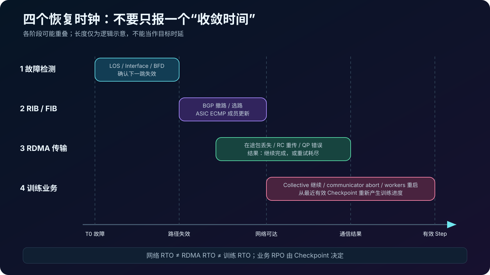
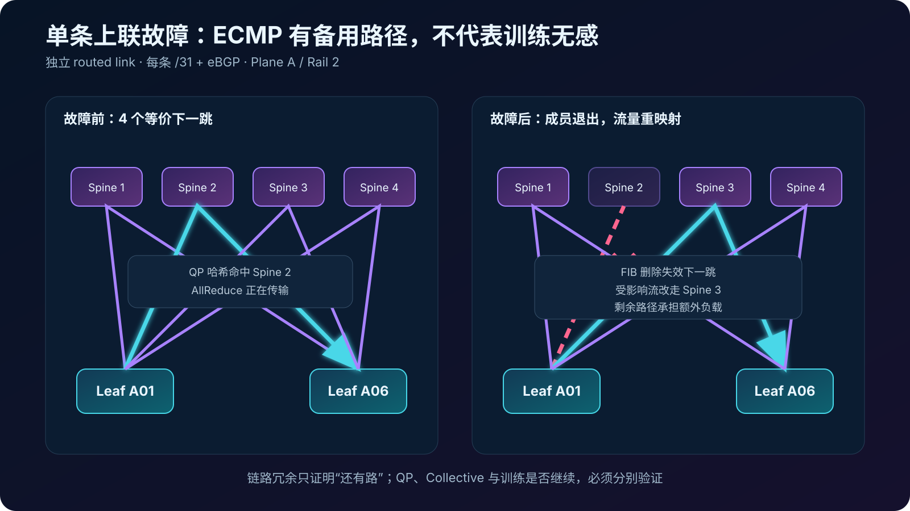
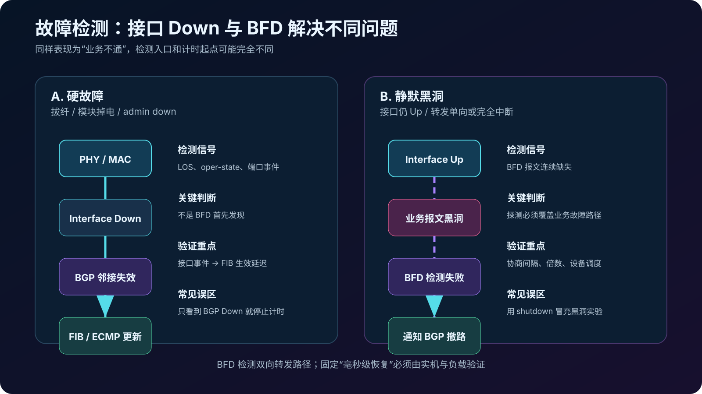
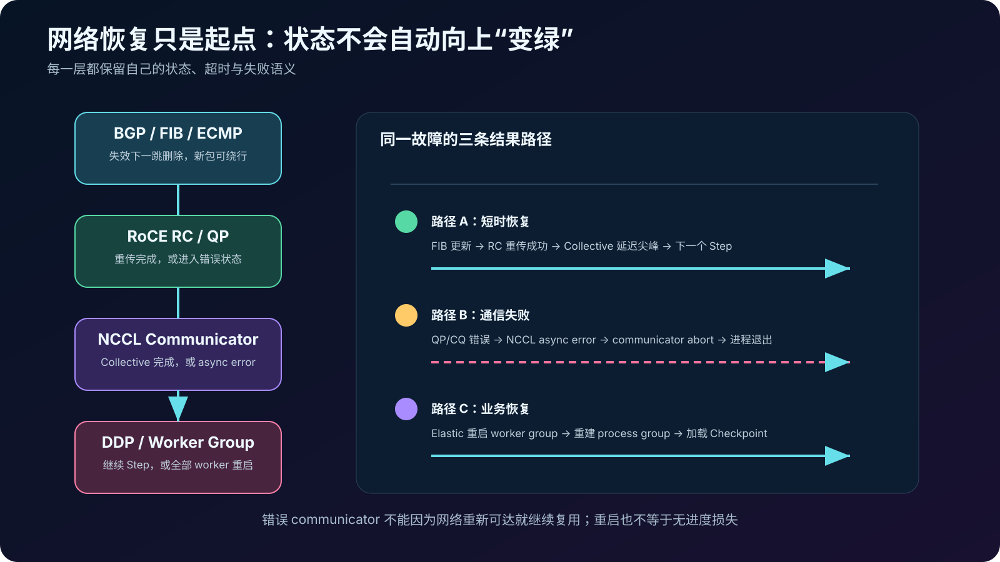
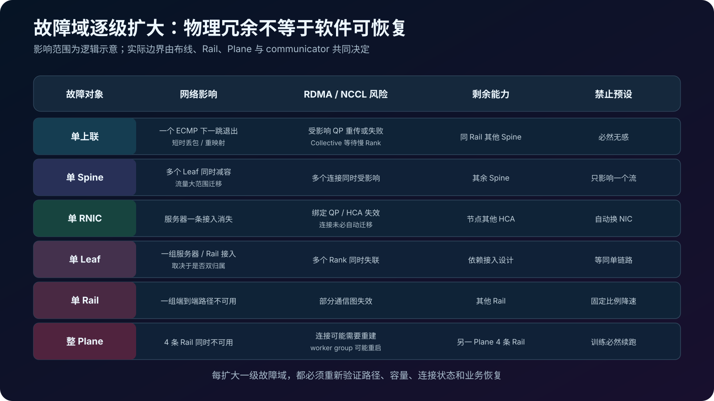
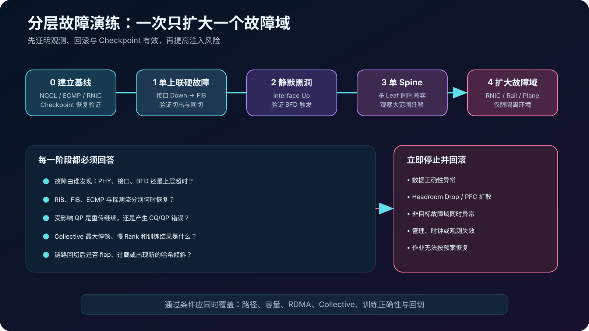

## 0. 前言

前面的[千卡 RoCEv2 网络建设](../rocev2-1024-gpu-network-design/)完成了 Leaf-Spine、Rail、IP 和双平面规划，[拥塞排障](../rocev2-congestion-troubleshooting/)与 [Multi-Rail/ECMP](../nccl-multirail-roce-ecmp/)又分别讨论了队列反馈和多路径利用。但架构图上的冗余还有一个更难的问题：训练过程中真的断掉一条链路，作业会发生什么？

答案不能只写“ECMP 会自动绕行”。链路故障、路由收敛、RDMA 传输恢复和训练恢复是四件事。前一层恢复，只是后一层继续运行的必要条件之一，并不是充分条件。

本文沿用 128 台八卡服务器、每台 8 张 400G RNIC、4+4 双平面的千卡算例，以跨 Leaf AllReduce 期间一条 Leaf-Spine 独立三层上联中断为主线。文中的时间线和日志均为**演练示意**，不是生产事故记录；具体时间必须由实际 NOS、ASIC、RNIC、驱动、NCCL 和训练框架共同验证。

## 1. 先分清四个恢复时钟

“网络恢复用了多久”不是一个足够精确的问题。至少要分别测量四段时间：

| 恢复层次 | 起点与终点 | 核心证据 | 恢复后代表什么 |
| --- | --- | --- | --- |
| 故障检测 | 物理或转发故障发生，到设备确认邻接不可用 | LOS、接口状态、BFD 会话、事件日志 | 设备已经知道路径坏了 |
| 控制面与数据面 | 邻接失效，到路由撤销且 ASIC FIB/ECMP 更新 | BGP RIB、FIB、ECMP 成员、探测流量 | 新报文存在可用网络路径 |
| RDMA 传输 | 首个受影响报文，到 QP 继续完成或进入错误 | RC 重传、超时、CQ/QP 错误 | 某条 RDMA 连接继续或失败 |
| 训练与业务 | Collective 开始受影响，到训练继续或从检查点恢复 | NCCL、watchdog、Step Time、退出码、Checkpoint | 作业恢复到可接受状态 |

这四段可能重叠，但不能合并成一个数字。网络在转发表更新后恢复可达，不代表丢失的 RoCE 包已经重传成功；QP 能继续，也不代表同步 Collective 没有超过上层超时；进程重新启动，也不代表没有回退训练进度。



架构验收应同时定义 RTO 和 RPO。RTO 不能只看 BGP 邻居恢复，而要落到“训练何时重新产生有效 Step”；RPO 则取决于最后一个完整可用的 Checkpoint，和交换机收敛时间没有直接换算关系。

## 2. 主案例：AllReduce 期间断掉一条上联

本文假设 Plane A 包含 Rail0～3，每台 Leaf 通过多条独立 routed link 连接多台 Spine。每条链路使用独立 `/31` 和 eBGP 邻接，不组成 LAG。一次 512 GPU 训练作业跨多个 Leaf 运行，其中部分 RoCEv2 流量通过 `leaf-a01 → spine-a02 → leaf-a06`。

在一次大消息 AllReduce 期间，`leaf-a01` 到 `spine-a02` 的一条 400G 上联被断开。该 Rail 仍然存在其他 Spine 下一跳，因此这是单故障，不是 Rail 或 Plane 整体失效。



故障发生前，多个 QP/流依据五元组等设备支持的哈希字段分布到不同 ECMP 成员。链路退出 ECMP 组后：

- 命中故障成员的流需要改走仍存活的下一跳；
- 使用 Resilient Hashing 的设备通常可以减少无关流的重映射，但具体行为取决于 ASIC 与配置；
- 故障窗口内已经发出的报文可能丢失，更新前后的报文也可能经历不同路径和时延；
- 剩余链路承接额外负载，故障后的拥塞、ECN/PFC 和收敛比仍需重新核算。

因此，“还有七台 Spine”只能证明拓扑有剩余容量，不能证明这次 Collective 一定无感完成。

## 3. 硬故障和静默黑洞不是同一种检测

### 3.1 拔纤、模块掉电与接口 Down

拔掉光纤、关闭端口或模块掉电通常会触发 PHY/MAC 的 Loss of Signal 或接口 Down。直连设备可以据此立即使链路和邻接失效；此时主要检测来源是物理层和接口状态，不应把它全部归功于 BFD。

大致过程是：

```text
光信号消失
  → 接口 oper-down
  → 直连 eBGP 邻接失效
  → 经该邻居学习的路径撤销
  → FIB/ECMP 组更新
  → 新报文改走其他 Spine
```

### 3.2 接口仍 Up 的静默黑洞

另一类故障更隐蔽：接口和光信号仍然正常，但转发路径中的某个方向已经不通。例如 ASIC 流水线异常、单向故障、错误 ACL 或中间设备停止转发。仅依赖接口状态无法发现它，BGP Hold Timer 又可能过慢。

[RFC 5880](https://www.rfc-editor.org/rfc/rfc5880.html)定义的 BFD 用来检测两个转发引擎之间的双向路径故障，并独立于具体路由协议运行。BFD 会话 Down 后可以通知 BGP 撤销对应路径；检测时间由协商后的发送/接收间隔、检测倍数、设备调度和实现共同决定，不能脱离平台承诺一个固定毫秒数。



要验证 BFD，不能再次使用 `shutdown interface` 代替静默黑洞。前者很可能由接口 Down 直接触发。更合理的隔离实验是在保持链路 Up 的前提下阻断探测和业务转发，并确认安全管理通道不受影响。

## 4. BGP 收敛之后，数据面还要完成什么

在独立三层链路模型中，每条 Leaf-Spine 邻接都对应一个下一跳。故障发现后，控制面需要完成三件事：

1. 将失效邻居和经它学习的路径从 RIB 中撤销；
2. 重新选择仍可用的等价路径；
3. 把结果下发到硬件 FIB 与 ECMP 组。

[RFC 7938](https://www.rfc-editor.org/rfc/rfc7938.html)描述了数据中心 Clos 中使用 BGP 与 ECMP 的设计思路；BGP 的协议行为则由 [RFC 4271](https://www.rfc-editor.org/rfc/rfc4271.html)定义。工程验收不能只看到 BGP 会话 Down 就停止计时，因为软件 RIB 已更新、硬件转发表已生效、业务探测恢复，可能是三个不同时间点。

### 独立 routed link 与 LAG 的差异

| 设计 | 单成员故障首先影响什么 | 路由视角 | 必须额外验证 |
| --- | --- | --- | --- |
| 独立三层链路 | 对应接口、BGP 邻接和 ECMP 下一跳 | 下一跳数量减少 | 路由撤销、FIB 更新、Resilient Hashing |
| LAG/Port-Channel | 聚合组内的成员 | L3 邻接通常仍然存在 | 成员剔除、聚合哈希、最小成员数和剩余带宽 |

两种设计都能提供并行带宽，但故障检测、重哈希范围和观测入口不同。不能拿 LAG 成员故障的结果，直接证明独立 eBGP 链路的收敛能力，反之亦然。

## 5. RoCE RC 会不会沿新路径继续

RoCEv2 把 RDMA 传输封装在 UDP/IP 上，网络收敛后，目的 IP 没有变化，后续包可以经新的三层路径到达对端。这并不等于 RNIC 建立了一条新的 QP；对 RC 传输来说，仍是原来的连接状态在面对丢包和延迟。

RC 使用包序号、确认与重试维护可靠传输。故障窗口内的包如果丢失，发送端可能在超时后重传；如果网络在重试预算耗尽前恢复，QP 有机会继续完成。如果故障持续过久、重试耗尽或设备报告不可恢复错误，QP/CQ 会进入错误路径，上层无法靠稍后恢复的路由自动把已失败操作变成成功。

这里有三个容易混淆的边界：

1. **ECMP 换路不是 RDMA Path Migration。** 对 RoCEv2 来说，它可以只是 IP Fabric 对同一源/目的流选择了另一个下一跳；是否支持以及是否使用 RDMA 层的备用路径机制是另一个问题。
2. **PFC 不能修复链路故障。** PFC 只对相邻链路上的指定优先级实施暂停，不能为断开的路径提供绕行。
3. **重传成功也不等于没有性能影响。** 同步 AllReduce 会等待最慢 Rank，一个 QP 的恢复停顿可能放大为整个 communicator 的 Step Time 尖峰。

RNIC 的超时、重试与错误计数器名称随驱动和固件变化。演练前应先确认设备实际暴露的 retry exceeded、timeout、out-of-sequence、CQE/QP error 等语义，而不是只搜索某个固定字段名。

## 6. NCCL 与训练框架看到的是什么

NCCL 通常会在多个 Channel、HCA 和 QP 上组织通信。一条物理链路故障可能只直接影响其中部分流，但 Collective 是协同操作：任何 Rank 或分块长期停顿，都可能阻塞整体完成。



可能出现三类结果：

### 6.1 短暂停顿后继续

网络和 QP 在上层超时前恢复，Collective 延迟出现尖峰，但最终完成。此时不能只记录“作业没挂”，还要记录最大停顿、是否出现重传、是否触发 PFC/丢弃，以及剩余 ECMP 成员是否过载。

### 6.2 Communicator 进入错误

NCCL 的异步操作在提交后仍可能报告错误。NVIDIA 的 [Communicator API](https://docs.nvidia.com/deeplearning/nccl/user-guide/docs/api/comms.html)明确要求：communicator 出错后应执行 abort，并且不能再假定已排队操作的完成状态或正确性。网络随后恢复，并不会让这个错误 communicator 自动变回可用。

PyTorch ProcessGroupNCCL 的 watchdog 与异步错误处理行为受版本和配置影响。`TORCH_NCCL_ASYNC_ERROR_HANDLING`、监控和 heartbeat 等变量应以实际 PyTorch 版本的[官方说明](https://docs.pytorch.org/docs/stable/torch_nccl_environment_variables.html)为准，不能复制一组环境变量就宣称具备故障恢复能力。

### 6.3 进程组重启并从 Checkpoint 恢复

TorchElastic 可以监控 worker；当 worker 失败或不健康时，Elastic Agent 会停止并重启整个 worker group，而不是在原 communicator 内透明替换一个 Rank。可参考 PyTorch 的 [Elastic Agent](https://docs.pytorch.org/docs/stable/elastic/agent.html)与 [torchrun](https://docs.pytorch.org/docs/stable/elastic/run.html)文档。

重新拉起只恢复了执行环境。训练能从哪里继续，取决于最近一次完整 Checkpoint 是否包含模型、优化器、学习率调度器、混合精度状态，以及任务需要的数据位置和随机状态。没有可用 Checkpoint 时，网络 RTO 再短也不能避免训练进度丢失。

## 7. 一条演练时间线应该怎样记录

下面是格式示例，不是目标数值：

```text
T0          [注入] leaf-a01 ↔ spine-a02 上联物理断开
T0 + Δdet   [网络] 接口/邻接失效，记录检测来源
T0 + Δfib   [网络] 失效下一跳从硬件 ECMP 组删除
T0 + Δpkt   [数据] 探测流量恢复，记录丢包与乱序窗口
T0 + Δrdma  [RNIC] 受影响 QP 完成重传，或产生 CQ/QP 错误
T0 + Δcoll  [NCCL] Collective 完成，或 watchdog/async error
T0 + Δjob   [训练] 下一个有效 Step，或进程组退出
T0 + Δapp   [业务] 从 Checkpoint 恢复并重新产生有效训练进度
```

所有时间必须来自统一时钟。交换机日志、RNIC 计数、NCCL 日志和训练指标如果无法对齐，就只能证明“这些现象都发生过”，无法证明谁先谁后。

建议至少保留下列证据：

| 层次 | 注入前基线 | 故障期间与恢复后 |
| --- | --- | --- |
| 物理端口 | oper state、光功率、FEC、错误 | LOS/Down 时间、错误增量、恢复抖动 |
| BFD/BGP | 会话状态、定时器、前缀数量 | 会话事件、撤路时间、邻接恢复 |
| FIB/ECMP | 下一跳成员、成员流量 | 成员删除/加入、流量迁移和剩余容量 |
| RNIC/RDMA | 吞吐、重传、CQ/QP 健康 | timeout、retry、错误和 Rail 差异 |
| NCCL | Collective P50/P95/P99、慢 Rank | 最大停顿、async error、日志首个异常 |
| 训练 | Step Time、loss、Checkpoint | 最后有效 Step、退出码、重启次数和数据正确性 |

## 8. 故障域扩大后，结论会怎样变化



| 故障类型 | 仍可能存在的路径 | 首要风险 | 训练结果不能预设为 |
| --- | --- | --- | --- |
| 单 Leaf-Spine 链路 | 同 Rail 的其他 Spine | 短时丢包、重哈希、剩余链路拥塞 | 必然无感 |
| 单 Spine | 其他 Spine | 多个 Leaf 同时减少容量、流量大范围迁移 | 只影响一条流 |
| 单 RNIC/服务器上联 | 节点的其他 HCA/Rail | 已绑定连接失效、GPU-NIC 映射改变 | NCCL 自动改用其他 NIC |
| 单 Leaf | 取决于服务器双归属和 Rail 设计 | 一组节点或 Rail 接入同时失效 | 等同单上联故障 |
| 单 Rail | 其他 Rail | communicator 中部分路径不可用、总带宽下降 | 只降低固定比例带宽 |
| 整个 Plane | 另一 Plane | 4+4 方案仅剩另一组四张 NIC，连接可能需重建 | 作业必然不中断 |

这张表刻意不写固定恢复时间。单 Spine 故障虽然保留其他 Spine，却会让许多 Leaf 同时重算；单 RNIC 故障虽然节点还有七张网卡，已经建立的连接也不一定能迁移；4+4 双平面保留一半物理带宽，也不代表当前 communicator 已经在另一平面建立了可继续使用的等价连接。

## 9. 分层故障演练 Runbook

故障演练不是“随机拔线看会不会挂”。应先定义业务窗口、管理旁路、回滚动作、停止条件和证据负责人，再按影响范围逐级扩大。



### 阶段 0：建立无故障基线

- 固定拓扑、NCCL 版本、消息大小、算法策略和作业规模；
- 重复运行足够长时间，记录 Collective 分布而不只保存最好结果；
- 保存 BGP/BFD、FIB/ECMP、逐 RNIC 和逐交换机端口快照；
- 验证 Checkpoint 可以真正恢复，而不只是文件存在。

### 阶段 1：单条非关键上联硬故障

- 选择存在其他等价下一跳、不会切断管理面的链路；
- 先开始稳定负载，再在约定时间注入故障；
- 分别记录接口检测、BGP/FIB、探测流、RDMA 和 Collective 恢复；
- 恢复链路后观察流量是否重新分布，避免只验证故障切出、不验证回切。

### 阶段 2：静默黑洞与 BFD

- 在隔离环境保持接口 Up，同时阻断被测方向的转发；
- 验证实际由 BFD 而非接口 Down 触发路径撤销；
- 核对 BFD 报文是否与业务经历一致的故障路径，避免“探测正常、业务黑洞”。

### 阶段 3：单 Spine，再到更大故障域

单链路通过后再验证单 Spine。RNIC、Leaf、Rail 和 Plane 会直接扩大到主机连接与 communicator 生命周期，只能在具备作业重启、Checkpoint 和独立管理通道的环境继续。

### 全局停止条件

出现以下任一情况应停止扩大故障域并恢复环境：

- loss、权重或校验结果出现数据正确性异常；
- Headroom Drop、不可控 PFC 扩散或持续队列溢出；
- 非目标链路、Rail 或 Plane 同时异常；
- 管理面、时钟同步或指标采集失效；
- 训练无法按预案终止、重启或从 Checkpoint 恢复。

## 10. 怎样定义“演练通过”

单链路演练通过不应只有“ping 没断”或“最终路由恢复”。至少分别给出：

1. **检测结果**：硬故障由接口状态发现，静默故障由计划中的检测机制发现；
2. **路由结果**：失效下一跳从 RIB、FIB 和 ECMP 组中退出，未误伤其他路径；
3. **容量结果**：剩余链路没有持续拥塞、丢弃、Headroom Drop 或不可接受的 PFC 扩散；
4. **RDMA 结果**：明确受影响 QP 是重传后继续，还是超时进入错误；
5. **NCCL 结果**：记录 Collective 最大停顿、慢 Rank、async error 和 communicator 状态；
6. **训练结果**：作业继续则验证 loss 与参数一致性，作业重启则验证恢复点与重算量；
7. **回切结果**：链路恢复后路由和负载稳定，没有反复 flap 或新的 ECMP 倾斜。

验收值必须从真实设备和业务 SLO 推导。BFD 配得更激进不一定更可靠：控制面负载、瞬时抖动和误判会同时上升；NCCL 或 PyTorch 超时配得更长，也只是延后失败暴露，不会修复已经不可恢复的 QP。

## 结语

链路冗余回答的是“还有没有物理路径”，BGP 与 ECMP 回答的是“新报文往哪里走”，RoCE RC 回答的是“已发送的数据能否完成”，NCCL 与训练框架回答的才是“这个作业还能不能继续”。把它们混成一句“网络会自动收敛”，就无法给生产训练作出可靠承诺。

真正可交付的故障设计，要把四个恢复时钟分别量出来，并把单链路、Spine、RNIC、Leaf、Rail 和 Plane 的影响逐级验证。只有当路由、RDMA、Collective、Checkpoint 和数据正确性都进入同一条时间线，冗余拓扑才从架构图上的连线变成能够兑现的恢复能力。
