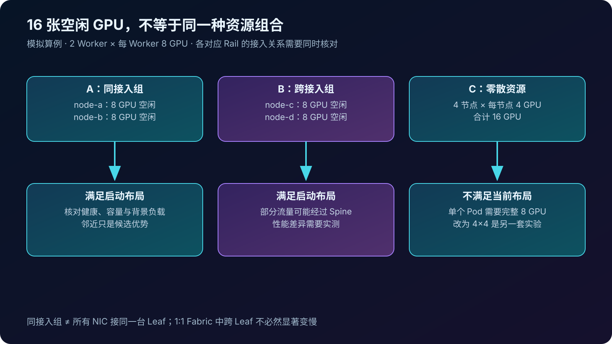
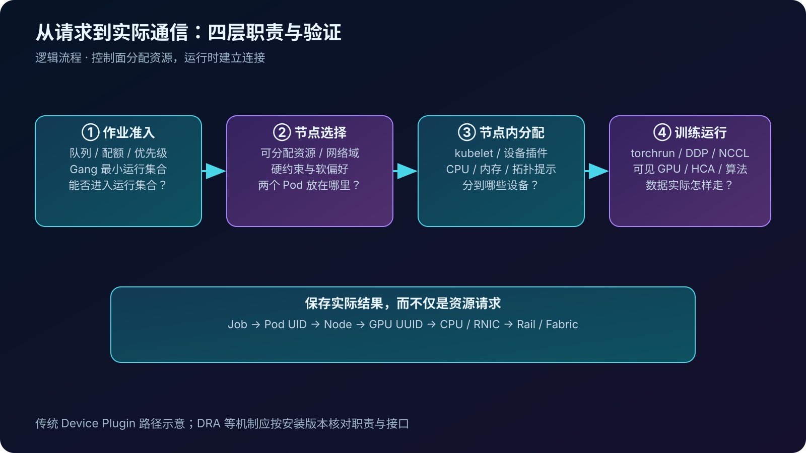
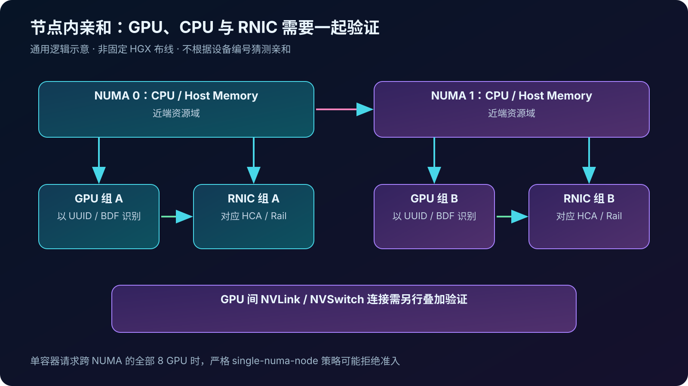
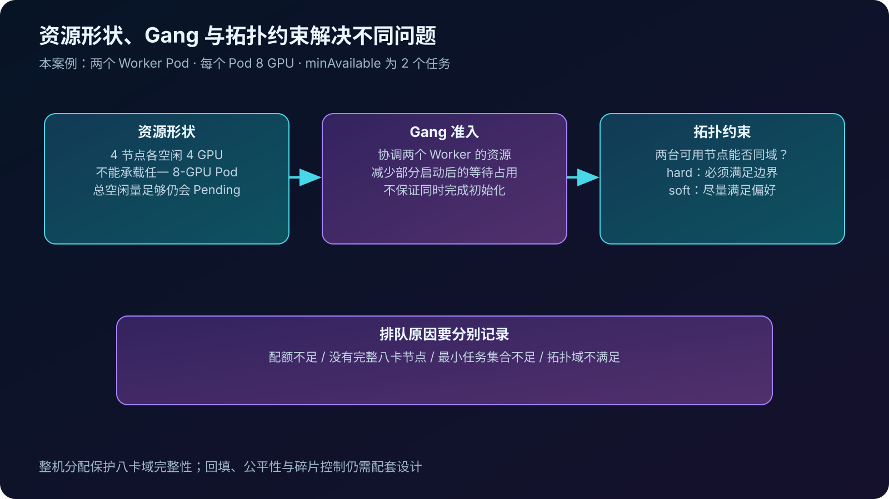
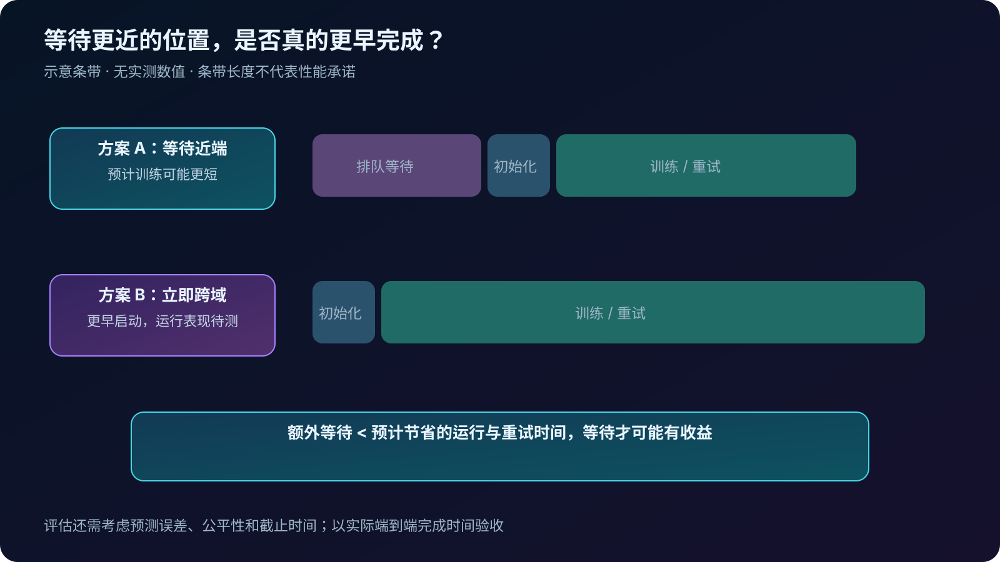
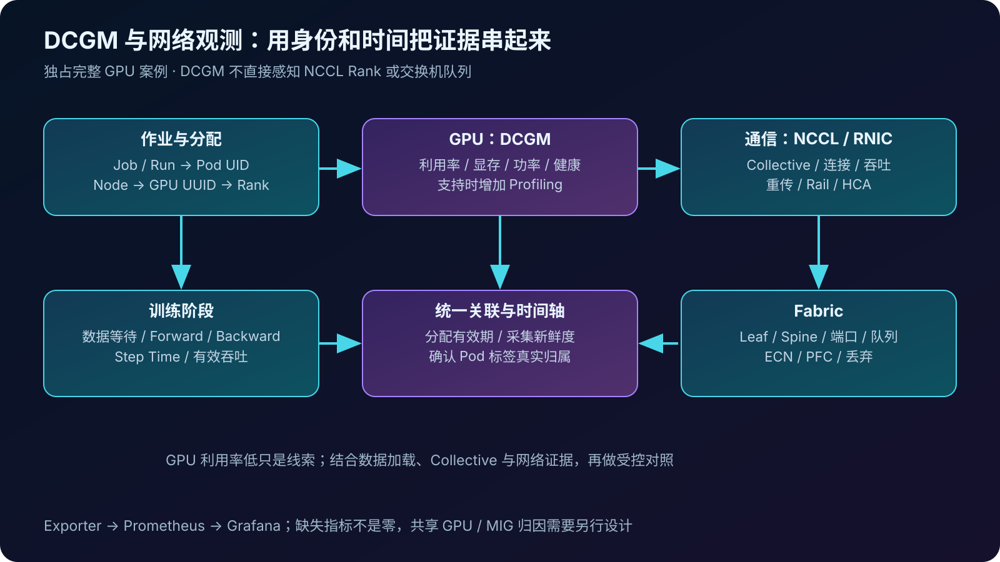

## 0. 前言

前面的文章已经把网络从设计讲到了运行：怎样建设千卡 RoCEv2 Fabric，GPU 怎样通过 RNIC 交换梯度，拥塞和断链又怎样影响训练。现在换一个角度：网络建好了，训练作业应该放在哪些机器上？

最近也开始接触 DCGM。它让这个问题多了一条验证路径：调度器认为资源已经分配完成，GPU 实际上是否忙于计算？如果训练变慢，应该继续调查 GPU、数据加载，还是 NCCL 和网络？

本文沿用 128 台八卡服务器、每节点 8 张 RNIC、4+4 双平面 RoCEv2 的算例，以一个双机 16 卡 DDP 作业串联调度和观测。候选节点、调度情境和实验均为教学设计，不是生产事故记录；没有实测的数据不填写收益数字。

## 1. 阅读前先分清这些术语

| 术语 | 本文中的含义 | 容易混淆的地方 |
| --- | --- | --- |
| 资源请求 | 作业声明需要多少 GPU、CPU、内存及哪些设备能力 | GPU 数量相同，不代表可用资源组合相同 |
| 拓扑感知调度 | 将设备和网络的连接关系纳入资源放置决策 | 不等于自动寻找当前最空闲的网络路径 |
| 亲和性 | 资源或任务之间希望满足的邻近、同域等关系 | 必须区分硬约束与软偏好 |
| NUMA | CPU 与内存访问距离不同的硬件组织 | NUMA 距离与 GPU 间 NVLink 距离不是同一张图 |
| Gang Scheduling | 将相互依赖的一组任务按最小可运行集合协调准入 | 不保证所有进程在同一时刻运行，也不保证训练成功 |
| 资源碎片 | 空闲资源存在，但分布不满足作业的形状或约束 | 集群总空闲量足够，作业仍可能排队 |
| DCGM | NVIDIA Data Center GPU Manager，提供 GPU 监测、健康检查等能力 | 不是集群调度器，也不是网络遥测系统 |
| DCGM Exporter | 将 DCGM 遥测暴露为 Prometheus 格式的组件 | 指标暴露与 Prometheus 抓取、存储是不同环节 |

GPU-NIC 数据路径可先读[GPU-NIC 拓扑篇](../nccl-allreduce-gpu-nic-topology/)；Fabric 的容量与平面设计见[千卡 RoCEv2 网络建设篇](../rocev2-1024-gpu-network-design/)。

## 2. 16 张空闲 GPU，为什么还要挑位置

本案例固定一个启动布局：两个 Worker Pod，每个 Pod 独占一台节点的 8 张完整 GPU，内部使用 torchrun 启动 8 个进程，合计 16 Rank。不启用 MIG、GPU 时间共享或超售；训练镜像、模型、数据与精度保持一致。

| 候选 | 当前资源 | 对本作业的含义 |
| --- | --- | --- |
| A | 同一接入域两台节点各空闲 8 GPU | 满足布局，优先考察其健康、容量和负载 |
| B | 不同接入域两台节点各空闲 8 GPU | 满足布局，但部分通信可能经过 Spine |
| C | 四台节点各空闲 4 GPU | 总数为 16，但不满足两个 8-GPU Pod 的布局 |

这里的“同一接入域”有明确条件：两台节点在各对应 Rail 上均属于同一个 Leaf 接入组。八路连接不一定接入同一台物理 Leaf，不能只看管理网机架标签判断距离。



如果将 C 改为四节点、每节点四卡，它可能成为可运行的新方案，但节点内/节点间通信比例、进程布局和性能都已变化，需要重新验证。资源总数相等不能直接替代资源布局。

A 也不是天然最快。1:1 Fabric、充足路径容量下，B 可能提供接近的性能；A 所在接入域如果拥塞，集中放置反而可能不利。拓扑是决策输入，实际完成时间才是验证结果。

## 3. 从作业提交到 NCCL 选路，谁负责什么



可以把整个过程拆成四个问题：

1. **作业能否进入运行集合？** 队列、配额、优先级和 Gang 机制决定是否具备足够资源。
2. **Pod 放在哪些节点？** 调度器结合可分配资源、约束和网络拓扑筛选、评价候选集合。
3. **节点上分到哪些设备与 CPU？** 在传统 Device Plugin 路径下，kubelet 与设备插件完成设备分配；Topology Manager 协调可获得的资源拓扑提示，CPU/Memory Manager 各司其职。
4. **训练数据实际怎样走？** torchrun 建立进程布局，NCCL 再依据可见设备、拓扑、参数和通信算法建立连接。

Pod 被绑定到节点，不等于 GPU、CPU、RNIC 已经获得最佳组合；拿到最佳组合，也不等于 NCCL 一定按人的预期使用所有 Rail。需要保存实际分配结果和 NCCL 连接证据。[Kubernetes Device Plugin 文档](https://kubernetes.io/docs/concepts/extend-kubernetes/compute-storage-net/device-plugins/)解释了设备分配与拓扑信息接口。

本文以传统扩展资源与 Device Plugin 模型为主。使用 DRA 等资源分配机制的环境，应另查对应版本的设备选择与拓扑语义，不能直接套用同一条分配链。

## 4. 节点内：GPU 分到了，还要看它离谁近



先在宿主机还原实机拓扑，再检查容器中的可见设备：

```bash
nvidia-smi --query-gpu=index,uuid,pci.bus_id --format=csv
nvidia-smi topo -m
lspci -tv
numactl --hardware
ibdev2netdev
rdma link show
```

建立一张 `节点 → GPU UUID/PCI BDF → NUMA → HCA/端口 → netdev → Rail/Leaf` 映射表。GPU index 和容器内 local rank 可能变化，长期关联应使用 UUID、PCI 标识及带时间的设备分配记录。

Kubernetes Topology Manager 协调的是节点内资源亲和，不负责跨 Leaf 放置；它的效果依赖参与组件提供的拓扑提示。CPU 独占还需要合适的 CPU Manager 策略与资源请求，内存绑定也有自己的配置条件。[Topology Manager 官方文档](https://kubernetes.io/docs/tasks/administer-cluster/topology-manager/)说明了这些边界。

不能把 `single-numa-node` 当作八卡训练的通用开关。若八张 GPU 分布在两个 NUMA 域，而一个容器请求全部八张 GPU，要求相关资源位于单一 NUMA 的严格策略可能导致准入失败。即使整个 Pod 合理跨 NUMA，内部八个进程仍应分别验证 CPU、内存和近端 RNIC 的关系。

GPU 的扩展资源申请也不会自动完成 RoCE 网络配置。RDMA 设备暴露、网络接口/IP、路由、QoS 与设备插件配置需要配套；共享 RDMA 设备资源的计数单位也未必代表一张独占物理 NIC。最终以容器可见性、实际 HCA 和数据路径为准。

## 5. 节点间：把物理网络转成可用的调度模型

### 5.1 先定义域，再表达偏好

主案例可以定义“同接入组 → 同网络 Pod → 同 Fabric”的性能域。这里的网络 Pod 指 Leaf-Spine 子域，与 Kubernetes Worker Pod 不是同一概念。模型应来自线缆、设备和路由事实，并带版本和更新时间；节点换线、故障降级后，调度元数据也需要更新。

4+4 双平面不能简单建成“节点只属于 Plane A 或 Plane B”的单棵树：每台节点同时连接两者。Rail、Plane 是多连接与故障维度；用于调度的层次结构只是经过设计的性能域抽象，表达不了的约束要单独维护和校验。

Volcano 的 HyperNode 可以表达层次化网络域，并提供 hard/soft 放置模式。本文采用其 [v1.11 网络拓扑文档](https://volcano.sh/docs/v1.11.0/keyfeatures/networktopologyaware/)中的基本概念；落地应固定安装版本、CRD 和调度器配置，而不是复制最新版字段到旧集群。

下面只是 Job spec 的局部字段示意，不能单独提交：

```yaml
spec:
  schedulerName: volcano
  minAvailable: 2
  networkTopology:
    mode: hard
    highestTierAllowed: 1
```

前提是管理员已经把 tier 1 定义为本案例的接入组，配置 HyperNode，并按安装版本启用对应功能。两个 Worker 各请求 8 GPU，且确实需要两个 Worker 才能运行，才可采用这里的 `minAvailable: 2`；它表示任务/Pod 数，不是 GPU 或 Rank 数。完整 Job 还必须提供任务、副本、资源与启动配置。

hard 表达必须满足的域边界；soft 表达尽量靠近，允许策略在资源不足时采用更大范围。字段是否生效应通过已安装 CRD、调度器日志和实际 Pod 放置核实，不能只看 YAML 被 API 接收。

### 5.2 Gang 解决启动集合，拓扑解决放在哪里



两个 Worker 互相依赖时，只启动一个 Worker 可能导致它拿着资源等待另一个。Gang 机制围绕最小运行集合协调资源，减少这种局部占用；它不保证镜像拉取、网络初始化和进程启动同步完成，后续仍可能失败。

本案例的任务布局在单个 Pod 请求 8 GPU 后，已使它无法使用只有 4 GPU 空闲的节点。Gang 再协调两个 Pod 的整体准入；拓扑策略进一步约束这两个 Pod 能否组成合适的候选域。这三种限制要分别记录，排队时才能说明原因。

整机分配有利于保持八卡互联域完整，却可能增加小作业等待；把小作业均匀散在所有节点上，又可能破坏大作业需要的完整八卡节点。资源池、回填、配额与公平性需要联合设计，不能只追求瞬时 GPU 占用率。

## 6. 等近端资源，还是立刻跨域运行

同接入组的节点暂时不够时，有两个选择：等待更近的资源，或者用已经可用的跨域节点启动。决策应比较：

```text
作业完成时间 = 排队时间 + 初始化时间 + 有效训练时间 + 故障重试开销
等待近端有收益的条件：额外等待 < 预计节省的运行与重试时间
```



这个关系是决策框架，不是准确预测器。剩余训练步数、模型通信比例、背景流量和释放时间都有不确定性。短作业可能更在意等待；长时间通信密集作业可能值得等候，仍需通过同类历史作业估计。

拓扑优先也不应饿死其他租户。看板应同时展示端到端完成时间、队列等待分布、有效训练吞吐和资源分配公平性；GPU 被占用，不代表它正在产生有效训练进展。

## 7. DCGM：从“资源分配完成”走向“GPU 实际在做什么”

### 7.1 DCGM 与 Exporter 的分工

DCGM 提供 GPU 遥测、健康监测和诊断能力；Exporter 将选定遥测暴露到 `/metrics`，Prometheus 再抓取，Grafana 用于展示。GPU Operator 可以管理相关组件，但本文不假定已经安装整套 Operator。[DCGM 文档](https://docs.nvidia.com/datacenter/dcgm/latest/)与[Exporter 介绍](https://docs.nvidia.com/datacenter/cloud-native/gpu-telemetry/latest/dcgm-exporter.html)可作为部署入口。

节点健康信息可以进入运维处置流程，但 Exporter 不会自动修改调度决策。隔离异常节点、更新设备健康或重试作业，都需要明确的控制组件和处置策略；单次 GPU 利用率低不应直接触发驱逐。

### 7.2 优先看哪些指标

下表列出常见字段，实际是否导出、单位、GPU 支持范围与 collector 配置，以所安装版本的 `/metrics`、HELP/TYPE 和官方字段定义为准。并非全部属于默认采集集合。

| 指标或字段 | 语义与用途 | 解读边界 |
| --- | --- | --- |
| `DCGM_FI_DEV_GPU_UTIL` | GPU 利用率，观察活跃与等待的变化 | 不是 FLOPS 利用率，也不能直接代表有效训练比例 |
| `DCGM_FI_DEV_FB_USED`、`DCGM_FI_DEV_FB_FREE` | 帧缓冲显存使用与空闲量 | 显存占满不代表计算忙；保留分配也会占显存 |
| `DCGM_FI_DEV_POWER_USAGE` | 功率，常见单位 W | 低功耗可能是等待，高功耗也可能包含通信开销 |
| `DCGM_FI_DEV_SM_CLOCK`、`DCGM_FI_DEV_GPU_TEMP` | SM 时钟与温度 | 结合设备功率/温度限制调查，不能单凭低时钟判故障 |
| `DCGM_FI_DEV_XID_ERRORS` | 最近一次 XID 错误码字段 | 不是错误次数或事件时间；非零值可能保留，需结合驱动日志判断何时发生 |
| `DCGM_FI_DEV_ECC_DBE_VOL_TOTAL` | 易失性双比特 ECC 错误计数 | 确认支持与复位语义，结合设备健康处置 |
| `DCGM_FI_PROF_SM_ACTIVE` | Profiling 中 SM 活跃程度 | 与 Tensor 活跃、占用率和业务吞吐不是同一指标 |
| `DCGM_FI_PROF_PIPE_TENSOR_ACTIVE` | Tensor 管线活跃程度 | 受精度、算子与设备支持影响，低值未必异常 |
| `DCGM_FI_PROF_DRAM_ACTIVE` | 设备内存接口活跃程度 | 不能直接替代应用有效内存带宽 |

字段选择参考 NVIDIA 的 [默认 collector](https://github.com/NVIDIA/dcgm-exporter/blob/main/etc/default-counters.csv)和[含 Profiling 的 collector](https://github.com/NVIDIA/dcgm-exporter/blob/main/etc/dcp-metrics-included.csv)。`main` 会变化，部署时保存对应 release 的配置副本。

Profiling 有硬件、驱动、权限和采集组合限制，还可能与其他性能分析工具争用资源；多组指标的采样方式也会影响时间解释。先确认可用性，再按设备文档配置，不把无数据当成零。健康诊断与在线监测也应分开，主动诊断的负载影响要按测试级别评估。[DCGM Feature Overview](https://docs.nvidia.com/datacenter/dcgm/latest/user-guide/feature-overview.html)说明了相关能力及限制。

### 7.3 从 GPU UUID 关联回作业



最小关联链为：

```text
Job / Run ID → Pod UID → Node → GPU UUID → 本次 local rank
Node + GPU PCI BDF → RNIC/端口 → Rail → 交换机端口
```

Exporter 在 Kubernetes 中可以结合 kubelet PodResources 信息为设备指标补充工作负载标签，但需要相应模式、访问条件和资源映射。不能假定任意部署都自带 Pod 标签；Prometheus 目标上的 `pod` 也可能指 Exporter 自己。检查实际样本的 `namespace`、`pod`、`container` 和 UUID，才能确认归属。[DCGM Exporter 源码与部署说明](https://github.com/NVIDIA/dcgm-exporter)提供相关配置入口。

Job 归属通常还需要 Pod owner/平台元数据；DCGM 不会天然知道 NCCL global rank。短生命周期 Pod、共享 GPU、MIG 会增加归因难度，本文独占完整 GPU 场景也要保存分配时间范围。不要用作业结束后的当前分配去解释历史指标。

下面是查询模板，不要求在本文机器上已部署：

```bash
# 本机转发到 Exporter 端点后检查；端口按部署实际值替换。
curl -fsS http://127.0.0.1:9400/metrics
```

```promql
# 对当前已导出的每条 GPU 利用率序列做时间平均，结果仍是百分数。
avg_over_time(DCGM_FI_DEV_GPU_UTIL[5m])

# 检查最近 5 分钟采样到的 XID 字段是否非零；不代表错误发生在这 5 分钟内。
max_over_time(DCGM_FI_DEV_XID_ERRORS[5m]) > 0
```

运行前确认这些样本有效、支持且新鲜，排除设备不支持的哨兵值。采集不到、Exporter 异常或标签丢失应单独显示为观测问题，不能补零后算入 GPU 空闲率。重复抓取目标也应去重，避免 GPU 数量翻倍。

## 8. 跨 Leaf 变慢了，怎样证明原因

假设实验发现跨 Leaf 放置的 Step Time 上升。这是待验证情境，按下面顺序调查：

1. **确认可比性**：相同模型、全局 batch、精度、梯度累积、软件和功率限制，排除预热、编译与数据缓存差异。
2. **核对实际放置**：保存节点、GPU UUID、进程 CPU 绑定、HCA 与网络域；验证请求和实际结果一致。
3. **对齐训练阶段**：记录数据等待、Forward、Backward、Collective 和优化器阶段。异步 CUDA 操作需要正确计时，不能直接用 Python 调用耗时充当 GPU 执行时间。
4. **看 DCGM 状态**：各 Rank 对应 GPU 是否同时下降，是否有单卡时钟、温度、功率或健康异常；降低采样粒度也不能替代细粒度执行追踪。
5. **关联通信证据**：Collective 变长时，RNIC、Rail、交换机端口是否出现吞吐倾斜、重传或队列拥塞；同步核对 NCCL 实际连接。
6. **做受控复测**：交换放置或恢复绑定后能否重复出现和消失。只看到 GPU 利用率下降与跨 Leaf 同时发生，仍不足以证明因果。

| 观察组合 | 下一步方向 |
| --- | --- |
| GPU 活跃下降，DataLoader 等待增加，Collective 无明显变化 | 数据供应、CPU 和存储 |
| Collective 变长，某 Rail 重传/队列/PFC 同时上升 | Fabric、远端端口与拥塞反馈 |
| 网络无明显异常，实际 CPU/RNIC 亲和变化 | PCIe、NUMA、GDR 与主机路径 |
| 单 GPU 时钟/健康异常，其他 Rank 跟随等待 | 单卡或节点健康，以及同步放大效应 |

这些是调查方向，不是单项指标诊断规则。GPU/NVLink 流量也不能替代 RNIC 的实际吞吐。网络证据的采集方法可接着读[拥塞排障篇](../rocev2-congestion-troubleshooting/)和[Multi-Rail 篇](../nccl-multirail-roce-ecmp/)。

## 9. 待执行：让调度收益成为可重复的实验

先用 NCCL Tests 隔离通信，再用有代表性的 DDP 模型验证作业结果。[双机 DDP 篇](../pytorch-ddp-16gpu-end-to-end/)的 22 参数模型用于功能验证，不适合作为这里的性能负载。

| 实验 | 主动改变 | 固定与核对 | 目的 |
| --- | --- | --- | --- |
| A | 同接入组 / 跨接入组放置 | 双机 16 Rank、绑定策略、HCA 集合、模型与网络基线 | 评估节点间位置 |
| B | 正确绑定 / 跨 NUMA 对照 | 同一节点集合和通信配置 | 评估节点内亲和 |
| C | hard / soft 放置策略 | 同一回放作业队列与资源变化情境 | 比较等待、运行和公平性 |

A/B 优先在预留节点上做；C 需要单独的调度回放或隔离资源池。三组不能混成一个实验。候选节点不同还可能带来硬件差异，应交叉轮换健康节点，记录背景负载，并重复独立运行。

```bash
# 在与训练进程相同的环境设置；不在这里强制算法或 GDR 策略。
export NCCL_DEBUG=INFO
export NCCL_DEBUG_SUBSYS=INIT,GRAPH,NET
export NCCL_DEBUG_FILE='/tmp/nccl-topology.%h.%p.log'
```

实际启动模板沿用 Multi-Rail 篇并转发所需环境变量。调试采集与低开销性能轮次分开记录；NCCL 日志、DCGM、RNIC、交换机和作业事件使用统一时间源。秒级 GPU 指标适合观察持续阶段，不足以解释微秒级 collective 或微突发。

| 放置/策略 | 实际节点与 GPU UUID | 排队/初始化 | Step Time 分布 / 有效吞吐 | Collective / algbw / busbw | DCGM / RNIC / 队列 | 正确性 |
| --- | --- | --- | --- | --- | --- | --- |
| 同接入组 | 待记录 | 待测 | 待测 | 待测 | 待测 | 待验 |
| 跨接入组 | 待记录 | 待测 | 待测 | 待测 | 待测 | 待验 |
| 绑定对照 | 待记录 | 待测 | 待测 | 待测 | 待测 | 待验 |

报告测试窗口、样本数、中位数与离散程度；样本不足时不宣称可信 P99。NCCL `busbw` 是 collective 归一化指标，不能直接当作全部 NIC 吞吐之和。最终同时验收训练正确性、完成时间、资源布局、网络状态和观测完整性。

## 结语

拓扑感知调度把物理连接转成了资源决策：作业需要什么形状的资源，节点之间怎样连接，节点内哪些设备更合适，以及为了更好的位置值得等待多久。

DCGM 让这次决策有了 GPU 侧证据；训练阶段、NCCL、RNIC 和交换机则补齐其余路径。把实际分配和运行表现关联起来，才能回答最关键的问题：这次调度是否让作业更稳定、更快地完成，而不只是让资源表里的空闲 GPU 变少。
